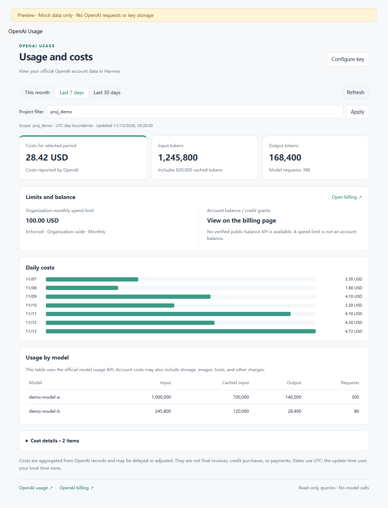

# OpenAI Usage for DeepSeek Harness

English | [简体中文](README.zh-CN.md)

View official OpenAI API usage and costs in **Settings → OpenAI Usage**. The interface follows Harness's language setting and supports English and Chinese.

## Features

- This month, last 7 days or last 30 days, for the whole organization or a selected project.
- Input, cached input and output tokens, request counts and usage by model.
- Official costs, daily spending and breakdowns by charge item / project. Currencies remain separate.
- Organization monthly spending limit when available, and a link to official billing for balances and credit grants.
- Admin API Key setup through Harness credentials, with access restricted to the owner.
- Clear partial-error states: unavailable data is never presented as zero spending.



The screenshot uses synthetic data.

## Install

Download the `.tgz` asset from [GitHub Releases](https://github.com/liuweiqiang2016/dsh-openai-usage/releases/latest), rather than the Source code archives. This project is not published to npm.

The package targets Harness `>=0.2.2-rc.1 <0.3.0` and Node.js `>=24.9.0`. Development and integration tests use the published `0.2.2-rc.1` services; compatibility with every version in that range is not guaranteed.

1. Launch Harness Desktop once to initialize the `desktop` profile.
2. Locate the desktop application's bundled `dsh` command using the application's command-management menu. Without PATH configuration, use the full path to `resources/runtime/cli/bin/dsh.cmd` inside the installation directory.
3. Exit Harness completely from the system tray.
4. Open PowerShell in the directory containing the downloaded package and run:

```powershell
dsh --version
dsh plugin --profile desktop add './dsh-openai-account-0.1.0.tgz'
```

5. Reopen Harness and select **Settings → OpenAI Usage**.

The repository is named `dsh-openai-usage`; the package and internal identifiers remain `dsh-openai-account` for compatibility with existing installations. Use the desktop application's bundled CLI to manage its profile. Installation may require internet access to resolve dependencies; the package already contains the compiled Host and Client.

To uninstall, exit Harness completely and run:

```powershell
dsh plugin --profile desktop remove dsh-openai-account
```

Uninstalling preserves the stored credential. Remove its reference using Harness's credential management and revoke the key in OpenAI when it is no longer needed.

## Configure an Admin API Key

An ordinary model API key cannot query the organization's administrative usage and cost APIs.

1. Open [OpenAI Admin keys](https://platform.openai.com/settings/organization/admin-keys) and select the organization whose API usage you want to inspect.
2. Create a dedicated Admin API Key, for example `Harness usage viewer`. If this option is unavailable, ask your organization administrator for access.
3. In the plugin, select **Configure key**, paste it into the password field, and select **Save and query**. Never paste credentials into a chat or GitHub issue.

The default credential reference is `OPENAI_ACCOUNT_ADMIN_KEY`. Harness's configured credential provider stores the value; it is not written to plugin configuration or included in query responses. The input clears after saving. Each query resolves the reference again, so rotating it does not require restarting Harness.

The plugin only sends GET requests to OpenAI. Admin keys may grant broader privileges; use a dedicated key and revoke it when no longer needed. A 403 response may indicate a wrong organization or insufficient permissions. An unavailable spending-limit endpoint does not prevent usage and cost queries.

## What the numbers mean

- Usage comes from `/v1/organization/usage/completions`; costs come from `/v1/organization/costs` and may include other products. Organization usage includes requests from other applications, not just Harness.
- Cached input tokens are already included in input tokens; do not add them together.
- Date ranges use UTC day boundaries and include today. The exclusive end boundary is the next UTC midnight so today's daily cost bucket is included. Today's figures may still change. The last-updated timestamp uses your local timezone.
- Costs may be delayed or adjusted. They are not a final invoice, payment history, prepaid balance or credit-grant total.
- The organization spending limit applies to the whole organization regardless of project/date filters. It is not an account balance.
- The plugin does not query credit grants or balances through an undocumented dashboard endpoint. Use the official billing link for those values.

Queries run when opening the panel, applying filters, saving a key or refreshing manually. There is no continuous background polling, model invocation or chat-content collection.

## Optional configuration

Defaults usually need no YAML edits. To change configuration, override the `openai-account` row's `config` in the profile's `cordis.patch.yml` using [Harness patch syntax](https://deepseek-harness.github.io/deepseek-harness/develop/basic/publish).

| Field | Default | Meaning |
| --- | --- | --- |
| `adminKeyRef` | `OPENAI_ACCOUNT_ADMIN_KEY` | Credential reference, not the key itself |
| `timeoutMs` | `30000` | Query timeout, 1000–120000 ms |

A config override replaces the whole row's config rather than deep-merging it. Install only one instance per profile.

## Development and validation

With Node.js 24.9 or newer:

```powershell
npm ci --ignore-scripts
npm test
npm run build
npm pack
```

Tests use synthetic responses. Coverage includes UTC boundaries and today's cost bucket, pagination, currency separation and adjustments, cancellation, credential rotation, owner checks, and activation/unloading in independent Cordis service contexts. HTTP integration tests exercise Connection authentication, Host/Origin admission and malformed requests.

`scripts/preview.mjs` builds a browser preview with mock data. `scripts/ui-check.mjs` takes the path to an installed Playwright module and uses headless Edge to check Chinese/English switching, filters, errors, narrow layouts and browser exceptions. It does not contact OpenAI or persist credentials. Full Electron UI validation is separate from these automated tests.

After building a linked local installation, exit Harness completely and reopen it to reload both Host and Client.

## Release process

Push changes to `main`. GitHub Actions tests on Windows and Linux. If the version in `package.json` has no release yet, the workflow builds a tarball and publishes it with `SHA256SUMS` to GitHub Releases. Existing releases are left unchanged. Bump the package/lockfile version and update `CHANGELOG.md` for the next release. No workflow runs `npm publish`; `private: true` also prevents accidental npm publication.

Add the `dsh-plugin` repository topic for discovery through the [Harness community plugin listing](https://github.com/topics/dsh-plugin).

## Implementation and references

The Host uses two exact authenticated routes on Connection's shared `/api` channel and checks owner access. This avoids the standalone RPC context-injection issue in `0.2.2-rc.1` without modifying Harness. The Client registers a settings section and shares the host's React runtime. Unloading aborts in-flight queries and removes the plugin's routes and UI registration.

- [Harness packaging and installation](https://deepseek-harness.github.io/deepseek-harness/develop/basic/publish)
- [Harness Desktop CLI](https://github.com/deepseek-ai/deepseek-harness/blob/master/apps/desktop/README.zh.md)
- [OpenAI usage API](https://developers.openai.com/api/reference/resources/admin/subresources/organization/subresources/usage/methods/completions)
- [OpenAI costs API](https://developers.openai.com/api/reference/resources/admin/subresources/organization/subresources/usage/methods/costs)
- [OpenAI admin APIs](https://developers.openai.com/api/docs/guides/admin-apis)

## License

[MIT](LICENSE) © 2026 liuweiqiang2016.
