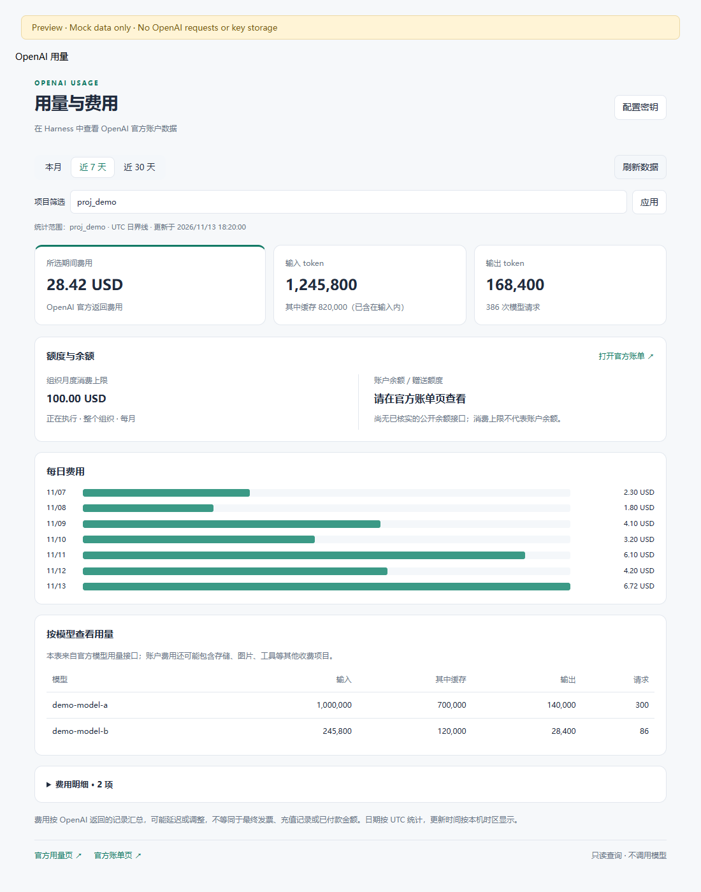

# OpenAI 用量 · Harness 插件

简体中文 | [English](README.en.md)

在 DeepSeek Harness 的 **设置 → OpenAI 用量** 中查看官方 OpenAI API 账户的用量、费用和组织月度消费上限。

页面跟随 Harness 的界面语言，支持中文和英文（英文名称为 **OpenAI Usage**）。侧栏名称、页面文案、错误提示与数字／日期格式随语言切换更新，日期统计边界仍为 UTC。

## 安装插件（推荐）

直接在 DeepSeek Harness 中添加本仓库，无需先下载安装包，也无需打开终端。

1. 打开 DSH 的**插件**页面，点击**添加插件**。
2. 在输入框中粘贴以下 GitHub 仓库地址：

   ```text
   https://github.com/liuweiqiang2016/dsh-openai-usage
   ```

3. 点击**安装**，等待完成；如 DSH 提示启用插件或重新加载，按界面提示操作。
4. 打开**设置 → OpenAI 用量**，按下方说明配置 **Admin API Key**，即可查询。

请填写上面的仓库地址，不是 README 页面地址。本项目未发布到 npm，不要只填写包名。安装时需要能够访问 GitHub 及依赖下载源。

仓库中已包含 Host 和 Client 的构建文件。兼容范围为 Harness `>=0.2.2-rc.1 <0.3.0`，以 `0.2.2-rc.1` 接口为开发与测试基线；可在“关于 DeepSeek Harness”中查看版本。

仓库名为 `dsh-openai-usage`；为兼容现有安装，包名和内部标识保留 `dsh-openai-account`，界面名称为 **OpenAI 用量 / OpenAI Usage**。

需要卸载时，在 DSH 的插件管理页面找到本插件并卸载。卸载不会删除 Harness 凭据服务中已保存的管理员密钥；如不再使用，可在凭据管理中清除对应引用，并在 OpenAI 平台撤销该密钥。

## 功能和统计口径

- 本月、近 7 天、近 30 天；使用 UTC 日界线，近 N 天包含今天，查询截止边界为次日 UTC 00:00（不含）。这样可包含今天的日桶及已记录费用；当天金额仍可能更新。更新时间按本机时区显示。
- 整个组织或指定项目 ID 的输入 token、输出 token、缓存输入和请求次数，按模型汇总。
- 官方 Costs 数据、每日费用和按收费项目／项目 ID 分组的明细。不同币种分别统计。
- 组织月度消费上限及是否正在执行。该上限始终是整个组织的配置，不受项目或日期筛选影响。
- 账户余额／赠送额度：截至开发时尚未核实可用的公开查询接口，提供官方账单页入口，不根据消费上限推算余额。
- 未配置时显示连接引导。401、403、429、超时、部分接口不可用分别显示状态，失败不显示为零费用。

模型用量取自 `/v1/organization/usage/completions`；费用取自 `/v1/organization/costs`，可能包含其他产品的收费项目。输入 token 已包含缓存 token，两者不相加。费用可能延迟或调整，不等同于最终发票、已付款金额、充值记录或账户余额。

本插件不读取聊天内容，不估算每个对话的费用，不调用模型。数据仅在打开面板、切换已应用筛选、保存密钥或手动刷新时查询，不在后台持续轮询。

## 配置 Admin API Key

账户用量、费用与消费上限查询使用 **Admin API Key**，与模型调用使用的普通项目 API Key 分开。

1. 登录 [OpenAI 管理员密钥页](https://platform.openai.com/settings/organization/admin-keys)。
2. 确认当前选择的是你使用模型的 API 组织。
3. 创建一个专用于本插件的管理员密钥，例如命名 `Harness usage viewer`。若当前账户没有创建入口或权限，请联系组织管理员；普通模型 API Key 不能替代管理员密钥。
4. 回到插件面板，点击“配置密钥”，在密码输入框中粘贴密钥，然后“保存并查询”。**无需将密钥发送到任何聊天。**
5. 默认凭据引用名是 `OPENAI_ACCOUNT_ADMIN_KEY`。实际值由 Harness 的凭据提供方保存，不写入插件配置、源码或查询响应。保存成功后输入框清空；下一次查询重新解析凭据，所以轮换后无需重启。

如果不希望在插件里输入密钥，也可通过 Harness 已有的凭据配置设置同名引用。插件只向 OpenAI 发出 GET 查询，但 Admin API Key 本身可能具备更广泛权限，建议为本插件单独创建并按需要撤销。

如果提示 403，请确认密钥属于正确组织且具有相应查询权限；如果只有消费上限不可用，用量和费用仍会独立显示。余额入口打开的是 OpenAI 官方页面，需要你自行登录。

## 可选插件配置

默认无需编辑 YAML。若确实需要调整凭据引用或超时，可在 `desktop` profile 自己的 `cordis.patch.yml` 中按官方 patch 语法覆盖 `openai-account` 行的 `config`。字段为：

| 字段 | 默认值 | 用途 |
| --- | --- | --- |
| `adminKeyRef` | `OPENAI_ACCOUNT_ADMIN_KEY` | Harness 凭据引用名，不是密钥值 |
| `timeoutMs` | `30000` | 单次账户查询超时，范围 1000–120000 毫秒 |

配置覆盖会替换整行 `config`，不会深度合并。一个 profile 只挂载一个本插件实例。

## 本地开发与验证

源码目录中使用 Node.js 24.9 或更高版本：

```powershell
npm ci --ignore-scripts
npm test
npm run build
npm pack
```

`npm test` 使用合成响应，不接触真实账户。测试覆盖 UTC 范围、缓存 token 口径、多币种／负数调整、完整分页、错误与取消、密钥轮换、owner 权限，以及独立服务上下文中的插件加载、卸载与重新加载。HTTP 集成测试使用发布版 Connection 的签名认证和共享 `/api` 桥接，检查 Host/Origin 与非法请求拒绝行为。

若桌面版通过本地目录链接安装本插件，构建后需要从系统托盘完全退出 Harness，再重新打开，以重新加载 Host 和客户端模块；仅刷新页面不足以更新 Host。

`scripts/preview.mjs` 生成 `artifacts/preview.html`，只使用模拟数据并加载实际构建出的客户端 factory。`scripts/ui-check.mjs` 接受本机已安装的 Playwright 模块路径，通过无头 Edge 验证筛选、刷新、保存交互、部分失败、窄屏布局与浏览器异常。预览支持 `?setup`、`?partial` 状态及 `?lang=en` 英文界面；测试覆盖中英文切换、错误提示翻译和窄屏布局。此预览不会连接 OpenAI，也不会保存管理员密钥。

已使用本地构建的 Host 完成真实 OpenAI 用量和费用接口的只读联调，确认次日 UTC 00:00 截止边界包含当天已记录费用。桌面端重启后的实际界面仍需验收；消费上限取决于账户及接口支持情况。验收时请使用同一组织、项目、UTC 日期范围对照官方用量页；账户用量不局限于 Harness，也可能包含其他应用发起的请求。

## 实现与参考

- Host：普通 Cordis 插件，在 Connection 的已认证共享 `/api` 通道注册 `/api/openai-account/overview` 和 `/api/openai-account/save-key` 两个精确 POST 路由，并额外拒绝非 owner Peer；凭据通过 `ctx.credentials` 解析和保存。此实现绕过 0.2.2-rc.1 独立 RPC 通道注册的 `webServer` 上下文注入问题，不修改 Harness 安装文件。
- Client：注册 `settings.section`；客户端构建为 Harness 所需的 lazy-CJS factory，通过宿主共享 React，不另起应用服务器。
- 卸载：中止在途 OpenAI 请求并撤销本插件的两个路由及界面注册，保留共享 `/api` 通道。
- [Harness 打包与安装](https://deepseek-harness.github.io/deepseek-harness/develop/basic/publish)
- [Harness 桌面命令与插件管理](https://github.com/deepseek-ai/deepseek-harness/blob/master/apps/desktop/README.zh.md)
- [OpenAI 用量接口](https://developers.openai.com/api/reference/resources/admin/subresources/organization/subresources/usage/methods/completions)
- [OpenAI 费用接口](https://developers.openai.com/api/reference/resources/admin/subresources/organization/subresources/usage/methods/costs)
- [OpenAI 组织消费上限](https://developers.openai.com/api/reference/resources/admin/subresources/organization/subresources/spend_limit/methods/retrieve)
- [OpenAI 管理接口与凭据说明](https://developers.openai.com/api/docs/guides/admin-apis)

## 界面预览

以下截图使用模拟数据。



## 许可证与发布

MIT，署名 liuweiqiang2016。主分支通过 Windows / Linux 测试后，CI 会为尚未发布的 package.json 版本创建 GitHub Release，并附带预构建安装包和 SHA256 校验文件；已有版本不会被覆盖。不运行 npm publish。
